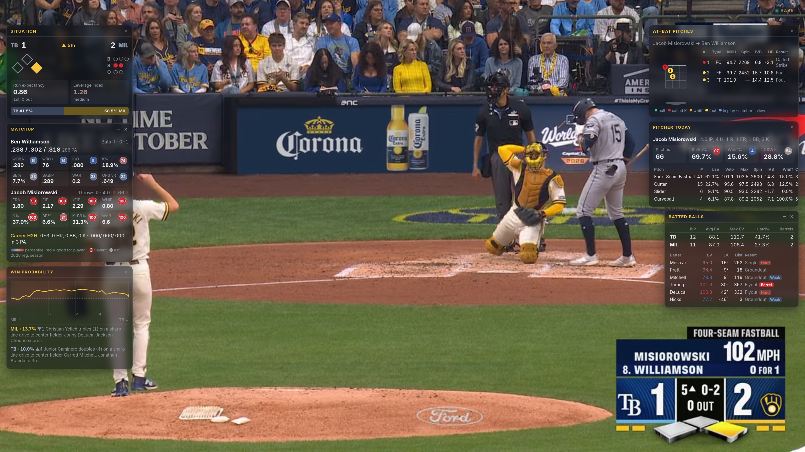
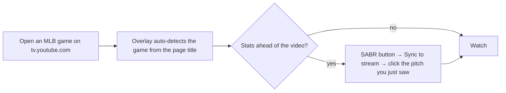
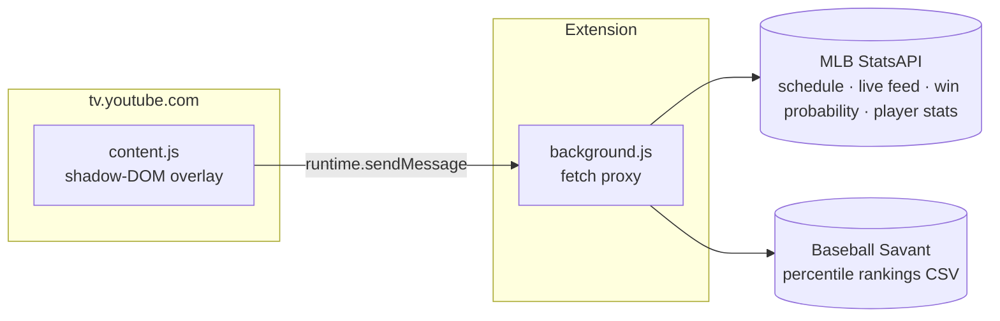
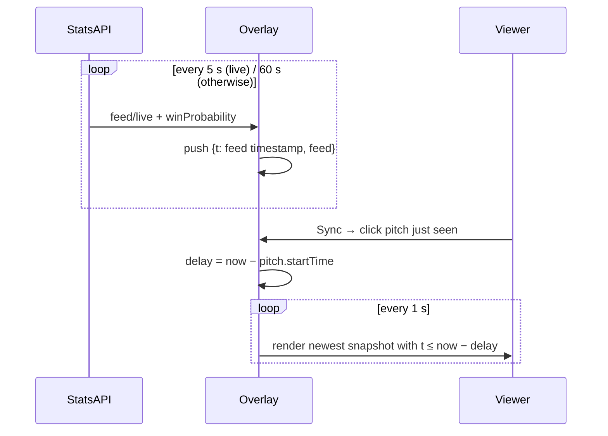

# SABR Overlay

Live sabermetrics panels on top of MLB broadcasts in YouTube TV. A Firefox extension, no build step, no backend.



[](https://github.com/harlanljones/sabr-overlay/actions/workflows/ci.yml)
[](LICENSE)

## Panels

| Panel | Shows |
| --- | --- |
| **Situation** | Score, bases/outs, count, run expectancy (RE24), leverage index, live win probability |
| **Matchup** | Batter and pitcher season sabermetrics with Savant percentile bubbles, platoon split, career head-to-head |
| **Win Probability** | Home WP chart across the game plus the biggest WPA swings |
| **At-Bat Pitches** | Strike-zone plot (catcher's view) and pitch-by-pitch type, velocity, spin, break, result |
| **Pitcher Today** | Line, Strike%, Whiff%, CSW% and per-pitch arsenal usage/velo/spin/whiff for this outing |
| **Batted Balls** | Exit velocity, launch angle, distance, barrels and hard-hit rate for both teams |

Every panel is draggable, minimizable and toggleable. Layout persists per browser.

## Install

Firefox only (Manifest V2, `browser.*` APIs).

```sh
git clone https://github.com/harlanljones/sabr-overlay
cd sabr-overlay
make run        # launches Firefox with the extension loaded (needs Node for web-ext)
```

Or load it manually: `about:debugging` → *This Firefox* → *Load Temporary Add-on…* → pick `manifest.json`.

To keep it across restarts, `make build` produces `sabr-overlay.xpi`; install it in Firefox Developer Edition or Nightly with `xpinstall.signatures.required = false`.

## Use



| Control | Action |
| --- | --- |
| `SABR` button (top right) | Settings: game, broadcast delay, opacity, size, panel toggles |
| `Alt+Shift+S` | Hide / show all panels |
| Drag title bar | Move a panel; others reflow down their column |
| `–` / `×` on a panel | Collapse / hide |

## How it works



The background script exists only so page CSP never blocks the fetches. `content.js` also works standalone (paste in a console) by falling back to direct `fetch`.

### Broadcast sync

Streams run 20–90 s behind StatsAPI. The overlay keeps a ring of feed snapshots keyed by MLB's own `metaData.timeStamp` and renders the newest one older than your delay.



### Derived stats

| Stat | Source |
| --- | --- |
| Run expectancy | RE24 table (2010s MLB averages) × base/out state |
| Leverage index | Linescore state via StatsAPI `winProbability` |
| Whiff%, CSW%, Strike% | Counted from `playEvents` pitch codes in this game |
| Barrel | Statcast EV/LA definition (EV ≥ 98, widening LA window) |
| Leverage index, win probability | StatsAPI `winProbability`, latest play |

## Develop

```sh
make lint       # web-ext lint
make run        # Firefox with live reload
make build      # sabr-overlay.xpi
```

Project layout:

```
manifest.json   extension manifest (MV2, Gecko)
background.js   fetch proxy for StatsAPI / Savant
content.js      everything else: data, state, panels, settings UI, CSS
```

`window.__sabrOverlayDebug` exposes `settings`, `games`, `poll()` and `render()` in the page console.

## Limitations

- Firefox only; Chrome needs an MV3 port (service worker + `chrome.*`).
- Game auto-detect relies on the YouTube TV page title; pick the game manually if it guesses wrong.
- Savant percentiles cover qualified players only; others get estimated bubbles.

## License

[Apache-2.0](LICENSE). Not affiliated with MLB, YouTube or Baseball Savant; data is fetched from their public endpoints under their terms.
